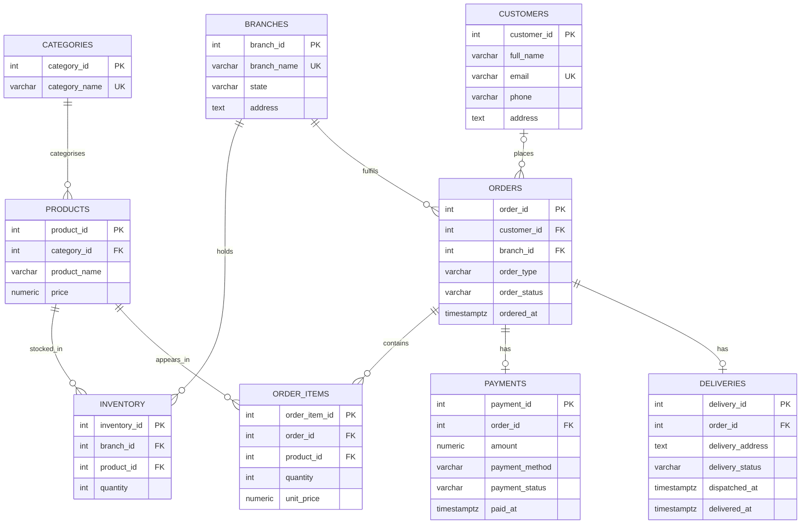

# 02 – Entity Relationship Diagram (ERD)

## Purpose
The ER diagram illustrates the nine tables in the Jantora Superstores PostgreSQL database and the relationships between them. It covers online orders, in-store purchases, branch inventory, payments and delivery tracking.

## Diagram

The editable source is [`er-diagram.mmd`](er-diagram.mmd). The diagram below can be viewed directly in GitHub if Mermaid rendering is enabled.

## Explanation of the relationships

| Parent | Related table | Explanation |
|---|---|---|
| Categories | Products | Each product belongs to one category; a category can have many products. |
| Branches | Inventory | A branch can have several inventory records, each representing a product stocked there. |
| Products | Inventory | The same product can have different stock quantities at different branches. |
| Customers | Orders | An order may have a customer, but walk-in purchases may not. Online orders must have a customer, enforced by a CHECK constraint. |
| Branches | Orders | Every order is assigned to one branch; a branch can fulfil many orders. |
| Orders | Order_Items | An order can have multiple line items. The database does not itself require at least one line item at the moment an order is created. |
| Products | Order_Items | Each line item refers to one product; a product can appear in many orders. |
| Orders | Payments | An order can have at most one payment record because `payments.order_id` is UNIQUE. |
| Orders | Deliveries | An order can have at most one delivery record because `deliveries.order_id` is UNIQUE. |

## Important design choices

- `inventory` links branches and products. The UNIQUE constraint on `(branch_id, product_id)` prevents duplicate stock records for the same product at one branch.
- `order_items` separates the products purchased from the order header. It stores the unit price at purchase time, so later changes to the product catalogue price do not alter the recorded sale.
- `orders.customer_id` is nullable to support walk-in purchases, but a CHECK constraint requires a customer for `ONLINE` orders.
- Payments and deliveries are optional records. The current schema permits only one of each per order; it does not yet support partial payments, repeated payment attempts, or multiple deliveries.
- The diagram describes structural relationships. Some operational rules, such as preventing overselling, require transaction logic and will be explored in Portfolio 3.

## Evidence

The diagram reflects `01_schema.sql`, which was used to create the nine tables in pgAdmin. Save a screenshot of the rendered diagram in the `evidence/` folder if required by the lecturer.
