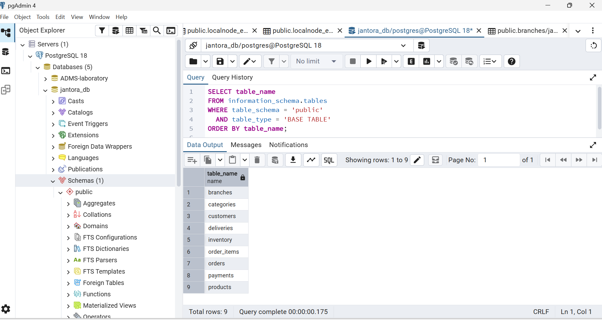
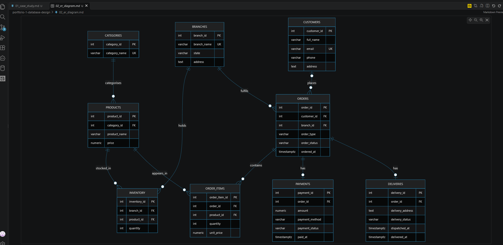
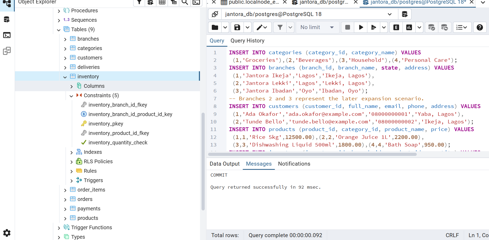

## Screenshots

### 1. Database Tables

The screenshot below shows the nine tables created in PostgreSQL for Jantora Superstores.

### 2. Entity Relationship Diagram

The diagram shows the nine entities and their relationships.

### 3. Database Keys and Constraints

The screenshot shows the keys and constraints implemented in PostgreSQL.

