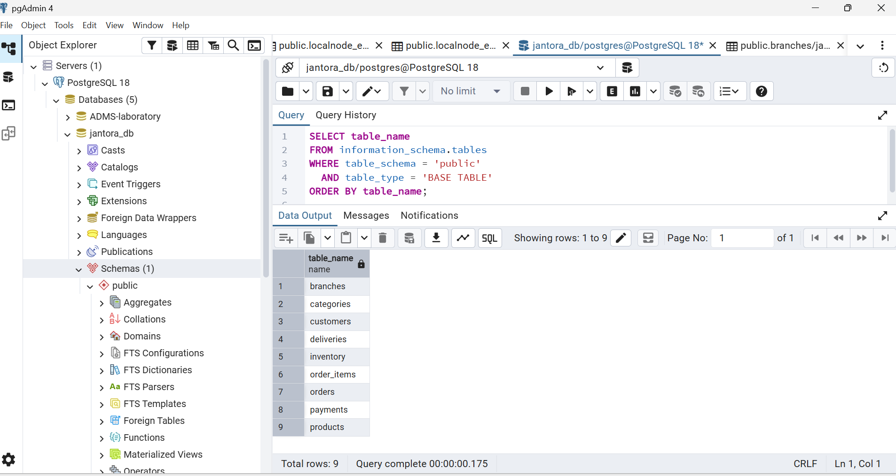
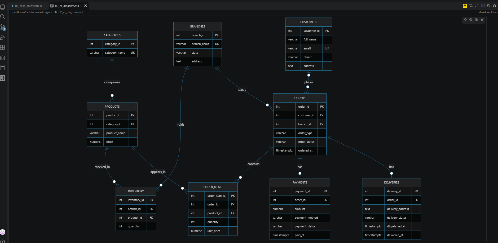
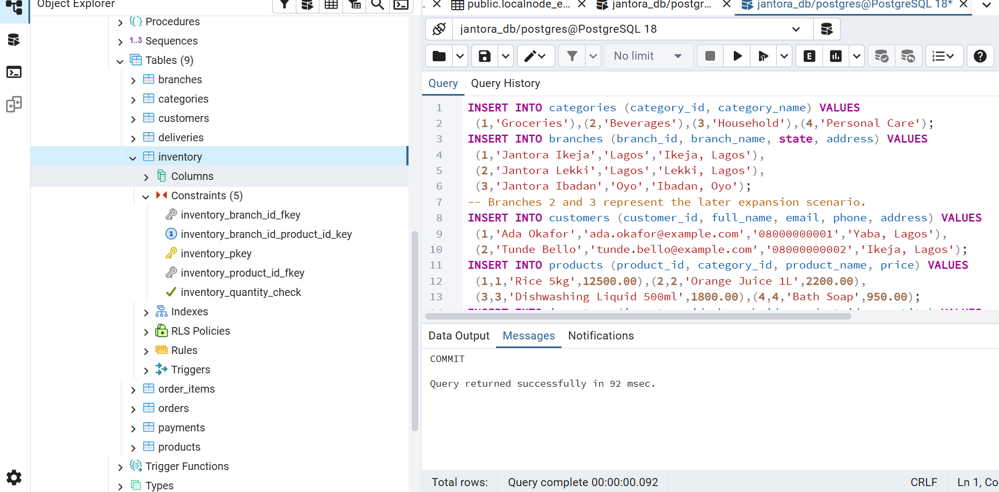

## Screenshots

### 1. Database Tables

The screenshot below shows the nine tables created in PostgreSQL for Jantora Superstores.

### 2. Entity Relationship Diagram

The diagram shows the nine entities and their relationships.

### 3. Database Keys and Constraints

The screenshot shows the inventory table's listed primary key, foreign keys, composite uniqueness and non-negative quantity check. It is an example of the implemented constraints, not evidence that every constraint across all nine tables was tested.

