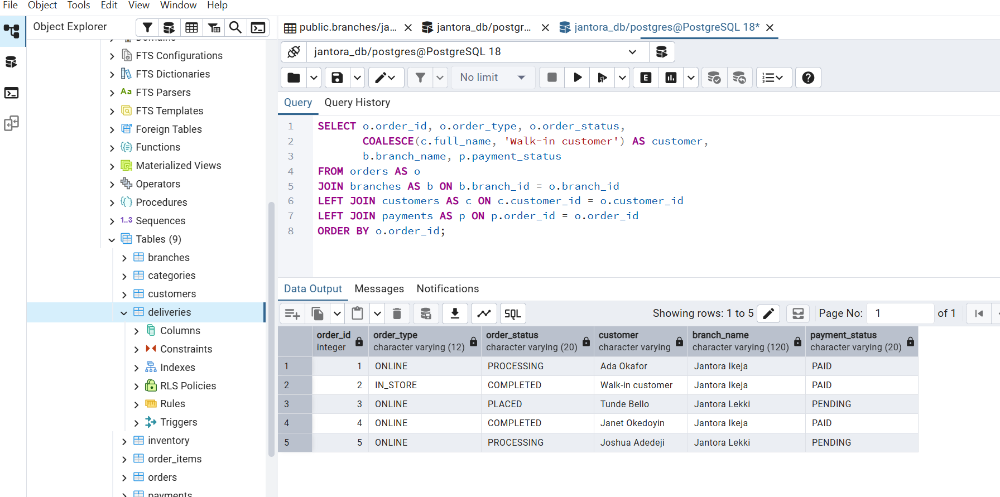
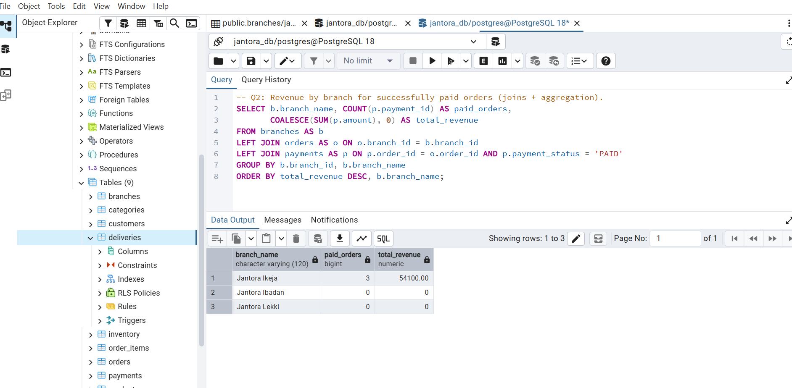
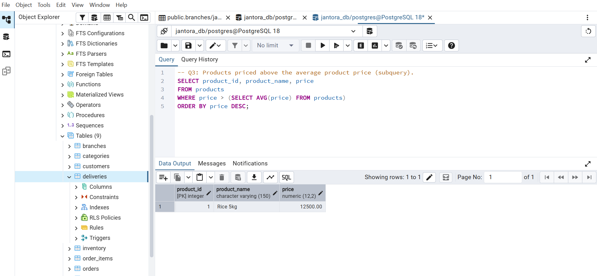
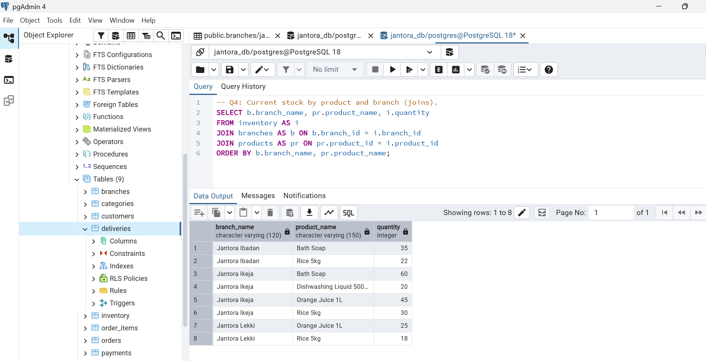
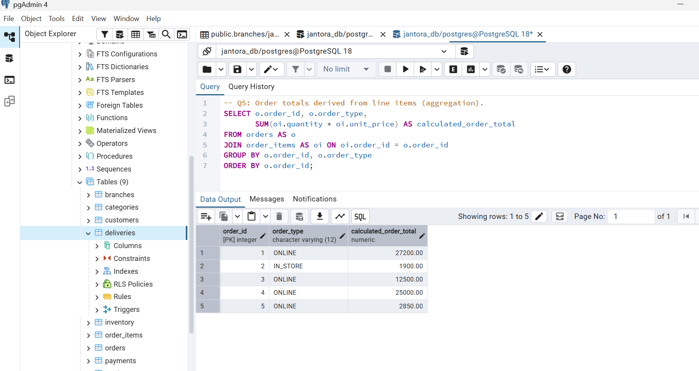
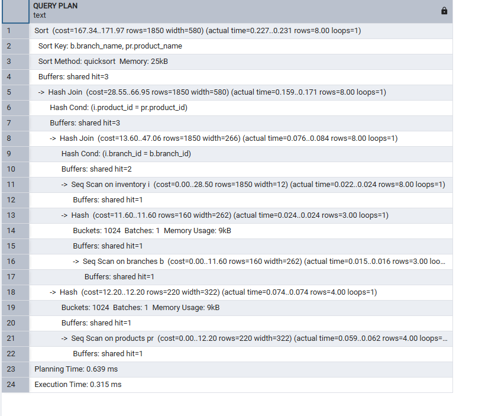
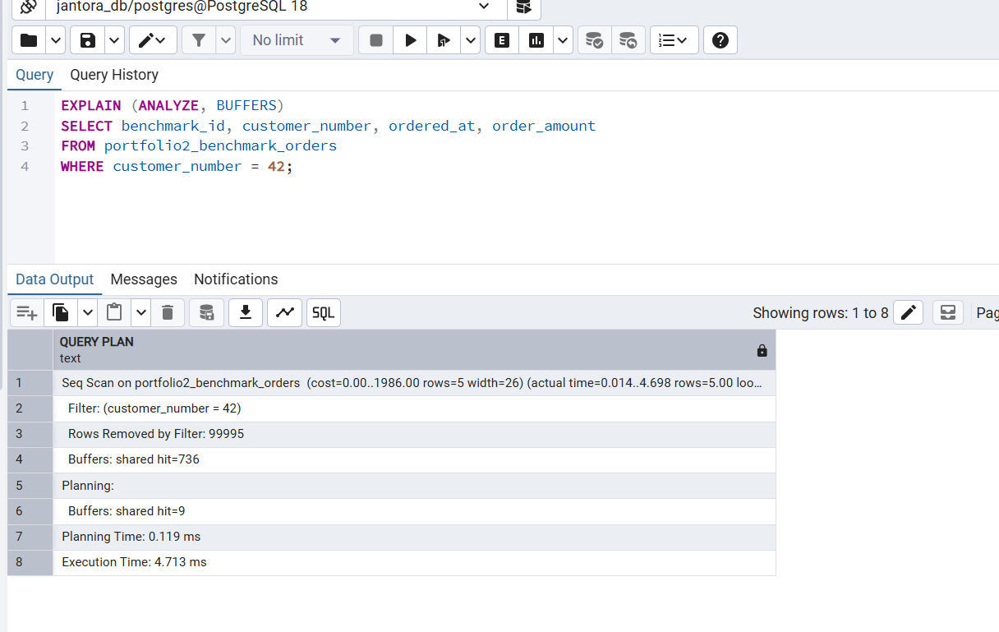
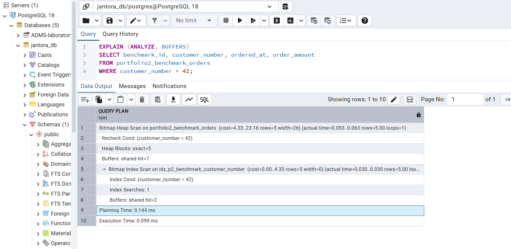

# Portfolio 2 — pgAdmin Implementation Evidence

This folder holds screenshots taken from actual PostgreSQL/pgAdmin work for Jantora Superstores. The names below match the references in `../performance_analysis.md`.

## Screenshot checklist

| Filename | What it should show |
|---|---|
| `01-order-details.png` | Order details with customer, branch and payment status |
| `02-revenue-by-branch.png` | Paid-order counts and revenue grouped by branch |
| `03-above-average-products.png` | Result showing Rice |
| `04-stock-by-branch.png` | Inventory quantities by branch and product |
| `05-order-totals.png` | Calculated totals from order items |
| `06-inventory-execution-plan.png` | Inventory plan with scan, join, sort and timings |
| `07-before-index.png` | Before-index plan and execution time |
| `08-after-index.png` | Repeated after-index plan and 0.099 ms execution time |

## Display screenshots on evidences

### Q1 — Order details

### Q2 — Paid revenue by branch

### Q3 — Above-average product prices

### Q4 — Stock by branch

### Q5 — Order totals

### Q4 — Execution plan

### Benchmark — Before index

### Benchmark — After index

