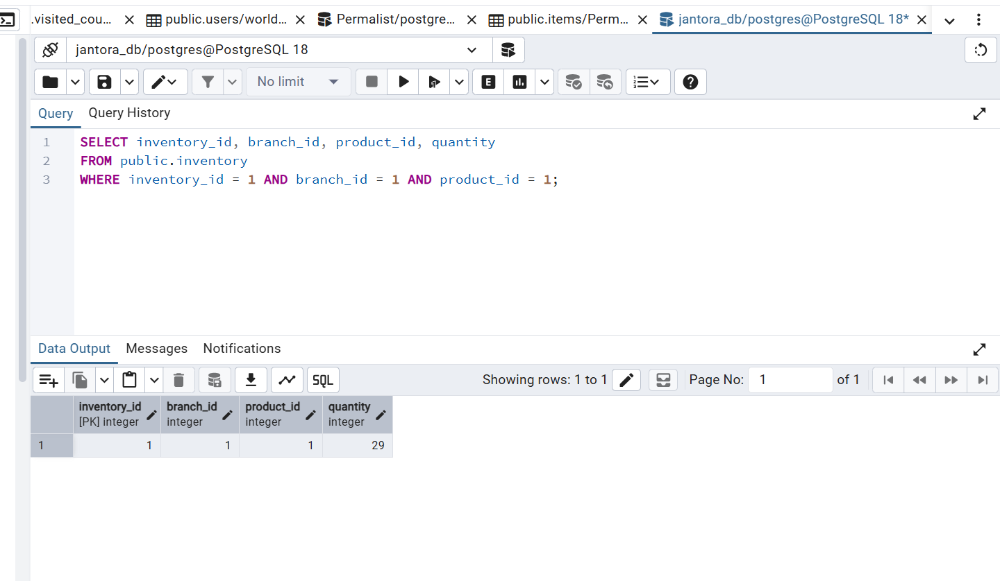
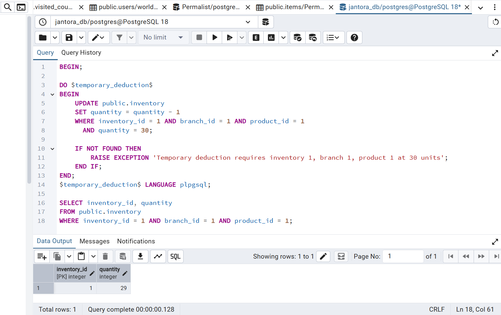
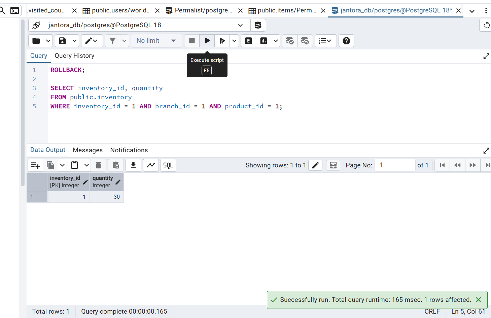
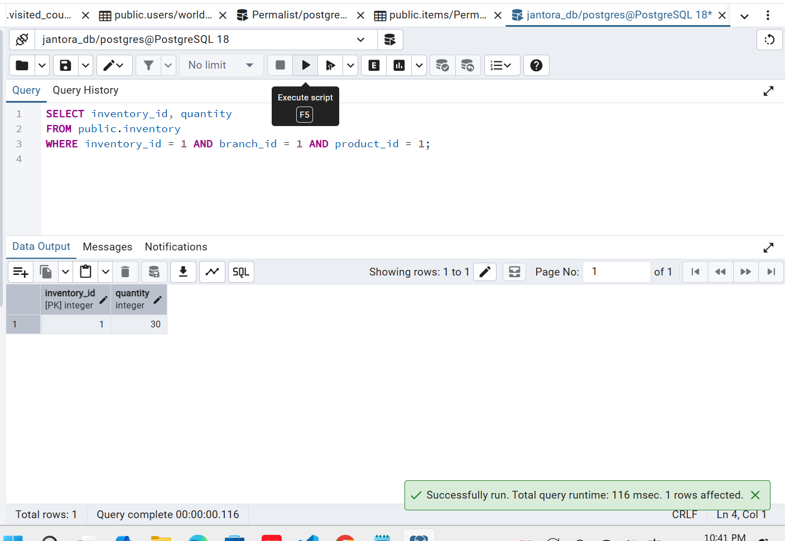
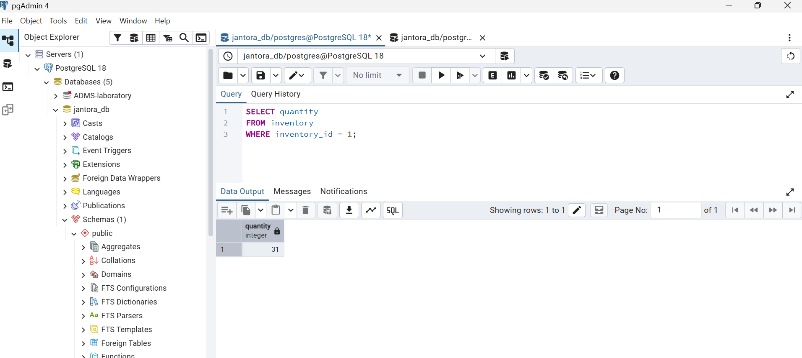
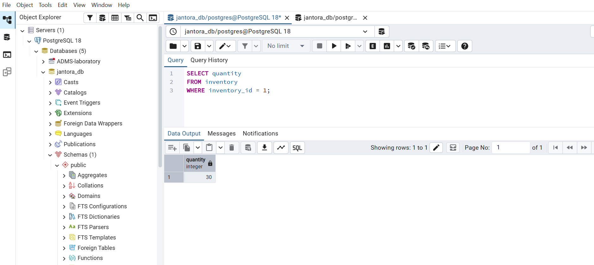
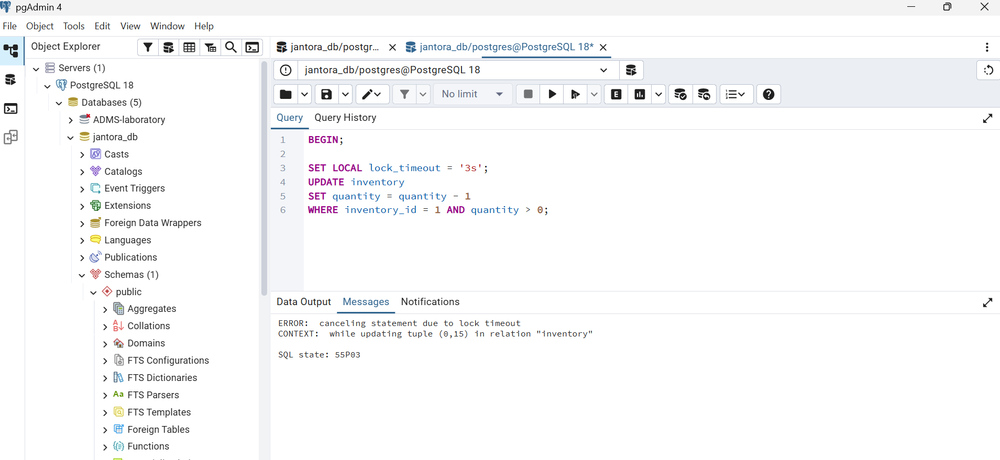
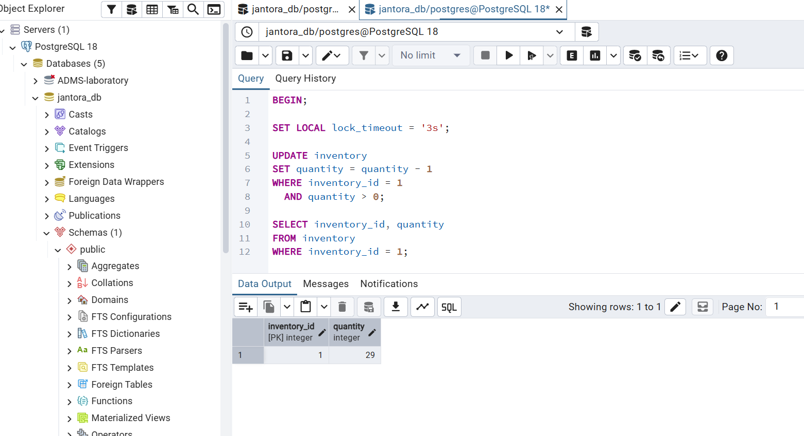
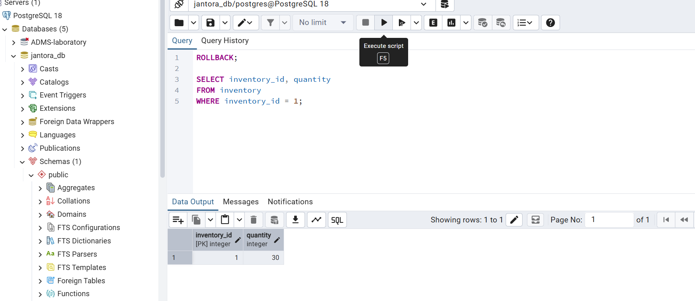

# Portfolio 3 — Transactions and Concurrency

**Requirement:** Transaction examples showing COMMIT, ROLLBACK, isolation, a concurrency issue/control mechanism, and screenshot/output evidence.

## Objective

Demonstrate how PostgreSQL handles reliable inventory updates and simultaneous access to the same stock record. All experiments use Jantora's existing `inventory` table; no extra demonstration tables were created. The tested record was `inventory_id = 1` (`branch_id = 1`, `product_id = 1`), initially holding **30 units**.

## Files and execution

- `01_transactions.sql` — COMMIT, ROLLBACK and inventory restoration.
- `02_isolation_levels.sql` — READ COMMITTED and REPEATABLE READ, using two pgAdmin sessions.
- `03_concurrency_test.sql` — row-level locking, a lock timeout, retry and rollback, using two sessions.
- `evidence/` — nine screenshots of the executed SQL and pgAdmin output.

Open `jantora_db` in pgAdmin Query Tool. Execute **only one labelled section at a time**, in the order specified by each script. For the isolation and concurrency tests, use two distinct database connections (Session A and Session B). The scripts use `inventory_id = 1` based on this run; check the row and its current stock before repeating the tests. The reset statements outside explicit transaction blocks require autocommit to persist. Avoid running stock updates or restoration steps more than once. The `01_transactions.sql` consistently targets inventory ID 1 for baseline, COMMIT, verification, restoration and ROLLBACK. Every update also requires branch ID 1 and product ID 1, with exactly 30 units before a deduction or 29 before restoration. If the target or quantity does not match, the section raises an exception; stop, ROLLBACK the failed transaction and inspect the state before proceeding. Run sections A-G in order in the same connection, starting with no open transaction and no concurrent stock edits. Section E leaves its temporary deduction open for Section F to roll back. The quantity guards reject immediate duplicate deductions or restorations but cannot prove execution history if another edit recreates an expected quantity; this is not a general reset procedure.

## 1. COMMIT and ROLLBACK

### COMMIT

A transaction deducted one unit from the inventory row and committed the update. A subsequent query confirmed that the quantity had changed from **30 to 29**. The reported procedure then used a **separate committed transaction** to restore stock from **29 to 30** before the next experiment. The screenshot shows the verification SELECT returning 29; it does not display the preceding COMMIT or the full restoration sequence.

### ROLLBACK

A new transaction temporarily deducted one unit, changing the quantity from **30 to 29**. Before committing, `ROLLBACK` discarded that update; the subsequent query showed **30** again. Final verification confirmed the original quantity remained intact.

## 2. Transaction isolation

The reported experiment used two separate pgAdmin Query Tool sessions. Session A started a transaction and read the stock quantity, while Session B committed an update from **30 to 31**. The table preserves the reported sequence; the supplied screenshots capture selected outputs rather than every step.

| Reported observation | READ COMMITTED | REPEATABLE READ |
|---|---:|---:|
| Session A's first read | 30 | 30 |
| Session B's committed update | 31 | 31 |
| Session A's next read, before its COMMIT | **31** | **30** |
| Session A's read after COMMIT | — | **31** |
| Quantity after the test's reset | 30 | 30 |

Under **READ COMMITTED**, Session A's new SELECT saw the change already committed by Session B. Under **REPEATABLE READ**, Session A continued to see its earlier snapshot (30) until its transaction ended. After COMMIT, a new SELECT saw 31. Each test's committed increment was reported as reversed by a separate update to restore the original 30 units.

The READ COMMITTED screenshot visibly shows a SELECT result of **31**; the REPEATABLE READ screenshot shows **30**. Neither image alone establishes the isolation setting, first read, other session's COMMIT, post-COMMIT read or reset. The interpretation is consistent with the supplied script and the reported execution order, but the screenshots are not a complete two-session transcript.

## 3. Concurrency control: row-level locking

Two sessions attempted to deduct stock from `inventory_id = 1` at the same time. Session A updated the quantity from **30 to 29** inside an open transaction, holding a row-level lock. Session B attempted to update the same row with `lock_timeout = '3s'` and received the expected **SQLSTATE 55P03** (`lock_not_available`), showing that the conflicting update could not proceed while Session A held the lock.

Session B rolled back its failed transaction. Session A then rolled back its uncommitted deduction, releasing the lock and restoring 30 units. Session B retried the update successfully (temporarily seeing **29**) and rolled it back. The final verification returned **30 units**.

## Findings and ACID properties

- **Atomicity:** ROLLBACK undid the uncommitted stock deduction as a single transaction.
- **Consistency:** The schema constrains inventory quantity to be non-negative. Restoring 30 units is test cleanup; it does not demonstrate every business invariant or an integrated order-and-stock workflow.
- **Isolation:** The reported two-session sequence illustrates different visibility under READ COMMITTED and REPEATABLE READ; the images show selected values rather than the complete sequence.
- **Durability:** The reported committed deduction remained visible to a subsequent query. This supports persistence after COMMIT in that run; restart and crash recovery are not demonstrated by the supplied evidence.
- **Concurrency control:** A row-level lock prevented a second session from modifying the same stock record concurrently; the lock timeout made the waiting behavior observable, and the retry succeeded after release.

These are observations from a controlled test of one inventory record, not a production workload benchmark. The lock screenshot directly shows the timeout and SQLSTATE; the retry image shows 29 and the final verification shows 30. The full ordering of session actions is documented by the script and reported account.

## Source attribution

The scripts and screenshots document the reported experiment. PostgreSQL's [Transaction Isolation](https://www.postgresql.org/docs/18/transaction-iso.html) explains statement snapshots under READ COMMITTED and transaction snapshots under REPEATABLE READ. [Explicit Locking](https://www.postgresql.org/docs/18/explicit-locking.html) describes conflicting row updates and lock release. These source links remain available until the final report provides a consolidated reference list.
