# Portfolio 4 — NoSQL and Advanced Data Models
 
**Technology:** MongoDB Atlas (document-oriented NoSQL)  
**Database:** `jantora_nosql` · **Collection:** `products`

## Objective

Demonstrate a NoSQL document model using the same Jantora case study as Portfolios 1–3, with implementation evidence and an explanation of suitability. This is a separate product-catalogue demonstration; the existing PostgreSQL `jantora_db` is not modified or replaced. 

## Document model and rationale

Each `products` document has a `product_id`, name, category, price, currency, nested `attributes` object, and embedded `stock_by_branch` array. Foodstuffs can have weight or volume while appliances have power and warranty fields. Flexible, category-specific product attributes are a strong fit for a document database.

The model embeds sample branch stock to demonstrate nested arrays, **not** to establish MongoDB as Jantora's authoritative inventory system. In a production deployment, frequently changing or transaction-critical stock, orders, and payments require careful consistency design and may remain in PostgreSQL. This portfolio uses illustrative/sample data, not verified copies of the PostgreSQL product records.

## Files

- `01_insert_documents.json` — four sample product documents to insert using **Atlas Data Explorer**.
- `01_create_and_insert.js` — reproducible **mongosh alternative** (upserts by `product_id`; does not erase existing data).
- `02_queries.js` — four equivalent queries for mongosh.
- `03_update_and_delete.js` — sectioned update, restoration, temporary insert and delete for mongosh.
- `evidence/` — eleven supplied Atlas screenshots of the completed experiments.

**Important:** Atlas Data Explorer's **Filter** field takes a filter document such as `{ "category": "Foodstuff" }`, **not** complete commands such as `db.products.find(...)`. The `.js` scripts are for **mongosh**, not the Atlas Filter field. 

## Reproduction

1. Use an Atlas collection named `jantora_nosql.products`. Insert the four documents from `01_insert_documents.json` once through Data Explorer's JSON mode, or run `01_create_and_insert.js` in mongosh as an alternative. Check existing IDs before insertion.
2. Apply the four filters in `02_queries.js` through Data Explorer, or execute the script in mongosh. The filters cover category, price, a nested attribute and an array element.
3. The update/delete script is sectioned: update the kettle warranty from 12 to 18, restore it to 12, insert temporary ID 9001, then delete that temporary document. Before repeating these modifications, verify the starting warranty and that ID 9001 is unused. The guarded updates may match no document if the starting value differs.
4. Verify the temporary ID is absent and inspect the kettle warranty separately. An unfiltered collection view with collapsed attributes does not establish the warranty value.

The scripts upsert by `product_id`, but no supplied script creates a unique index on that field. MongoDB's automatic `_id` uniqueness does not enforce `product_id` uniqueness. Sequential reruns can match existing records, while existing duplicates and concurrent upserts remain limitations. The insertion script uses `$setOnInsert`, so it does not reset existing document contents. The update/delete script's temporary-document upsert also leaves an existing ID 9001 unchanged; the subsequent deletion filter assumes that matching demonstration record belongs to this exercise.

## Observed results in MongoDB Atlas

The table shows visible screenshot results. The screenshots are supplied in `evidence/`.

| Experiment | Observed result | Screenshot |
|---|---|---|
| Database and collection | `jantora_nosql.products` created and visible | `01-database-collection.png` |
| Document insertion | Four sample products: Rice, Cooking Oil, Laundry Detergent, Electric Kettle | `02-insert-documents.png` |
| Nested document structure | Rice showed its `attributes` object and `stock_by_branch` array | `02a-document-structure.png` |
| Q1: `category = Foodstuff` | Rice and Cooking Oil | `03-foodstuff-query.png` |
| Q2: price greater than NGN 15,000 | Rice and Electric Kettle | `04-price-query.png` |
| Q3: weight attribute exists | Rice and Laundry Detergent | `05-nested-attribute-query.png` |
| Q4: Ikeja stock less than 10 | Electric Kettle (Ikeja: 8; Lekki: 5) | `06-array-query.png` |
| Update product | Electric Kettle warranty is visibly 18 months after the update; the earlier array-query image shows the original 12 | `07-update-result.png`, `06-array-query.png` |
| Restore warranty | Kettle warranty was restored to 12 months after the update; this restoration is not visibly established by the supplied final image | No dedicated restoration screenshot |
| Insert temporary test record | Product ID 9001 added for deletion testing | `08-temporary-document.png` |
| Delete temporary record | Product ID 9001 deleted; subsequent filter returned no document | `09-delete-verification.png` |
| Final verification | Four original products are listed; the kettle attributes are collapsed, so this image does not verify its restored warranty. The separate deletion filter shows temporary ID 9001 absent | `10-final-collection.png`, `09-delete-verification.png` |

The sample product data are deliberately illustrative and are not synchronised with the relational PostgreSQL database.

## Suitability and trade-offs

**Why a document model works:** Product attributes differ by category; a document can include nested product specifications and branch availability with fewer joins for a catalogue view. Product documents can evolve as Jantora introduces new categories.

**Trade-offs:** Duplicated branch information can become stale; embedding frequently changing stock in product documents complicates coordination across systems. MongoDB still supports indexes, schema validation, and transactions where needed, but flexible structure alone does not guarantee consistency. PostgreSQL's relational constraints remain useful for critical order and payment workflows.

**Comparison with other models:** Key-value databases are useful for shopping-cart/session lookup but less expressive for multi-attribute catalogue filtering. Wide-column databases can suit large-scale partitioned writes; graph databases suit relationship-heavy recommendations. The document model fits this demonstration's flexible product attributes and nested branch stock.

## Screenshot evidence

The following screenshots document the completed Atlas experiments.

**Atlas database and products collection**

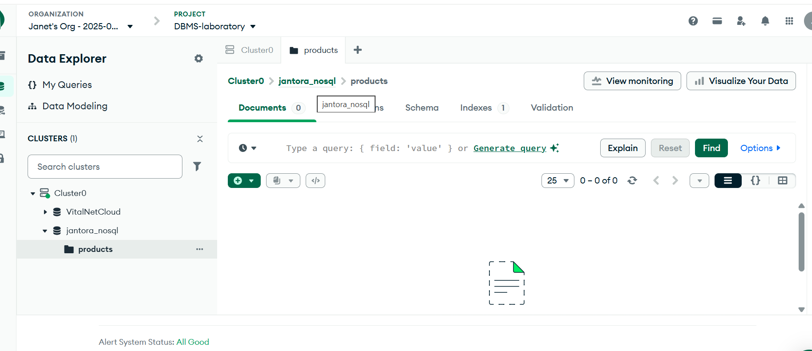

**Four Jantora product documents**

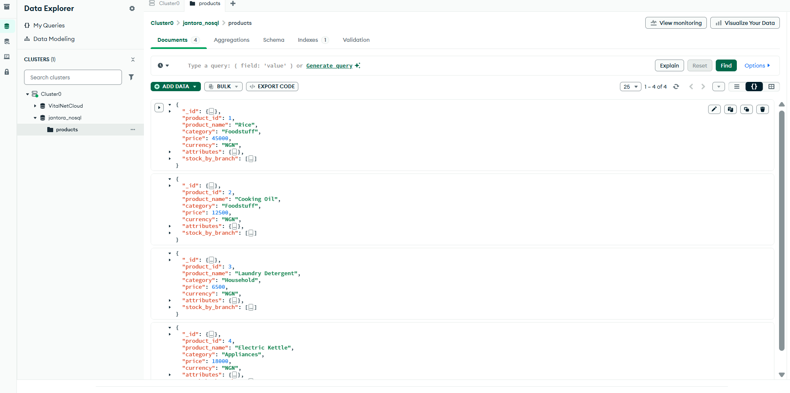

**Rice nested document structure**

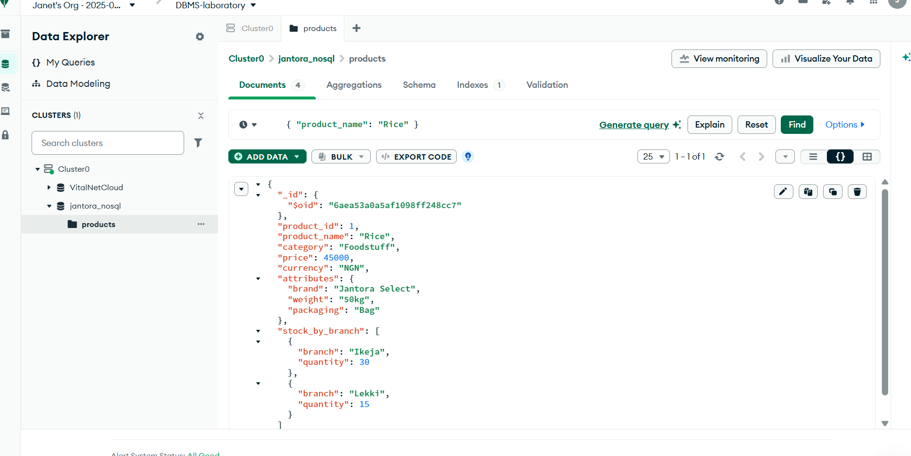

**Foodstuff category filter**

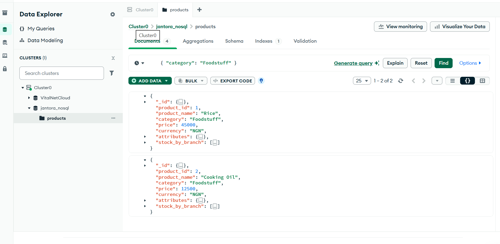

**Price comparison filter**

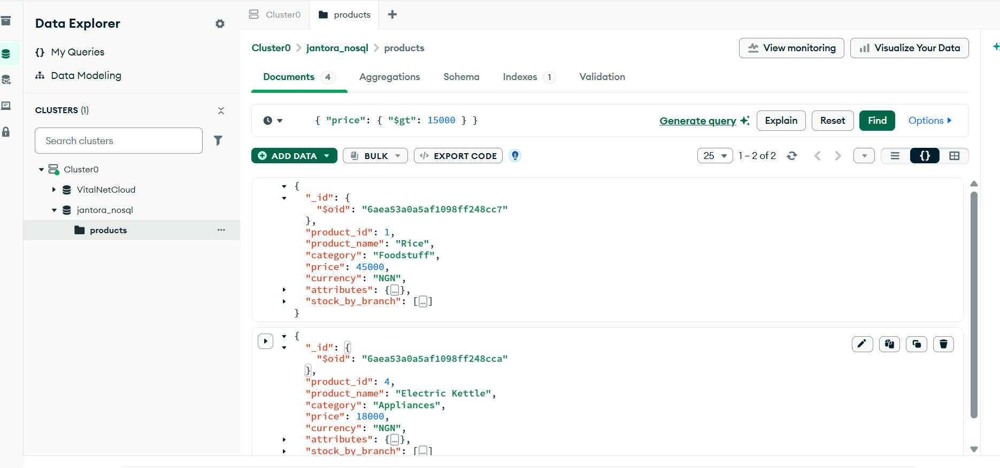

**Nested weight attribute filter**

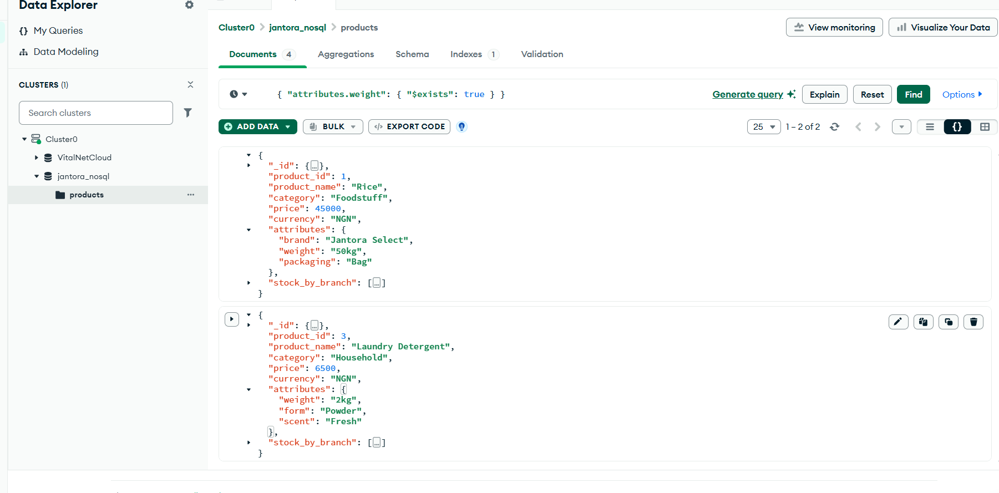

**Embedded array stock filter**

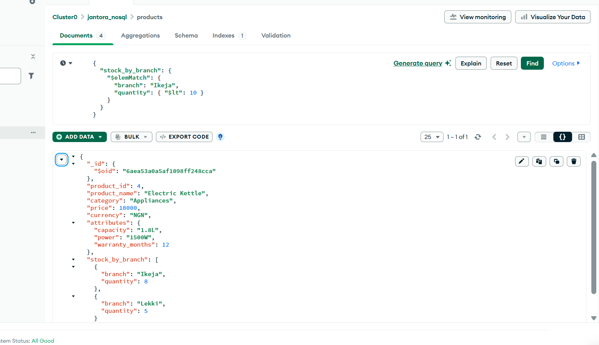

**Kettle warranty updated**

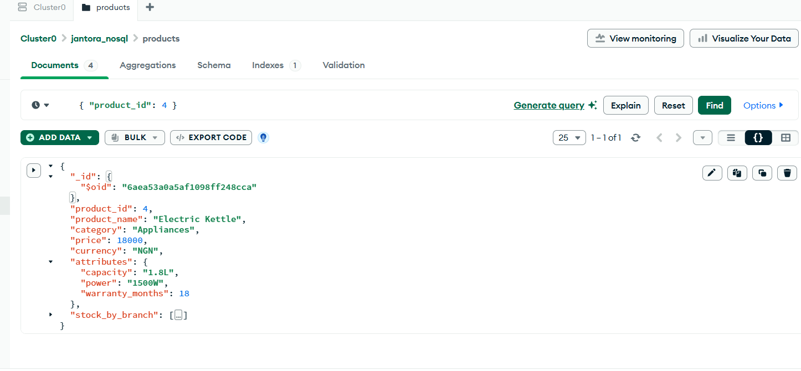

**Temporary test product**

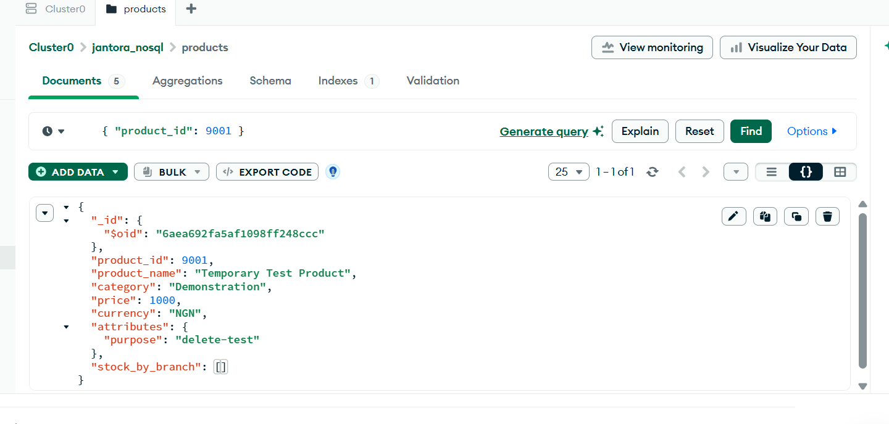

**Temporary product deleted**

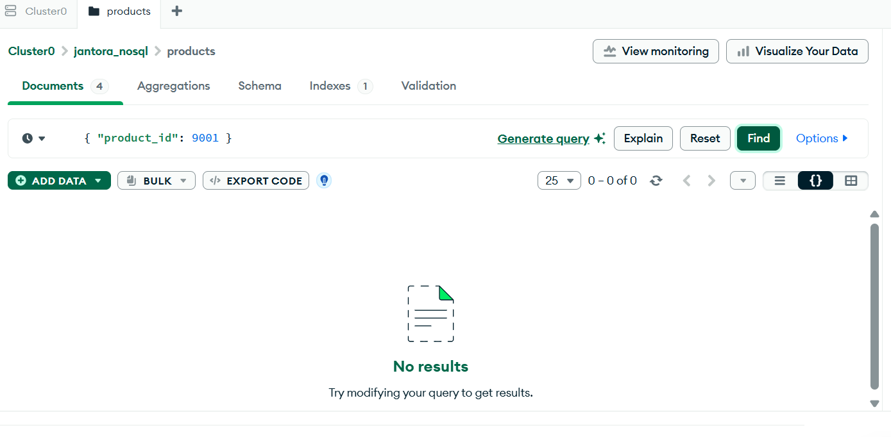

**Final four product documents**

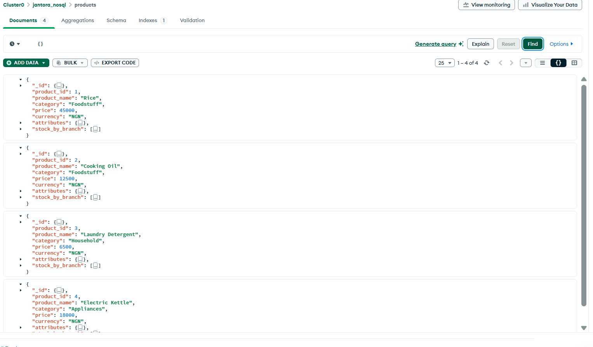

