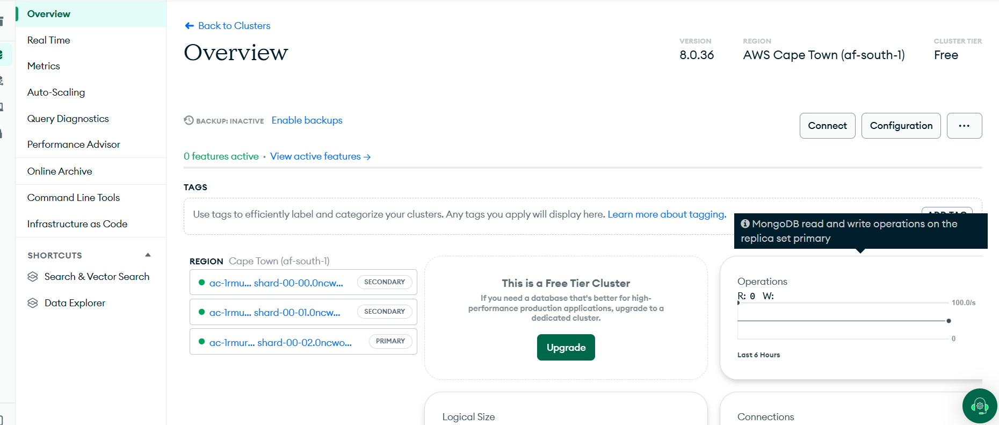
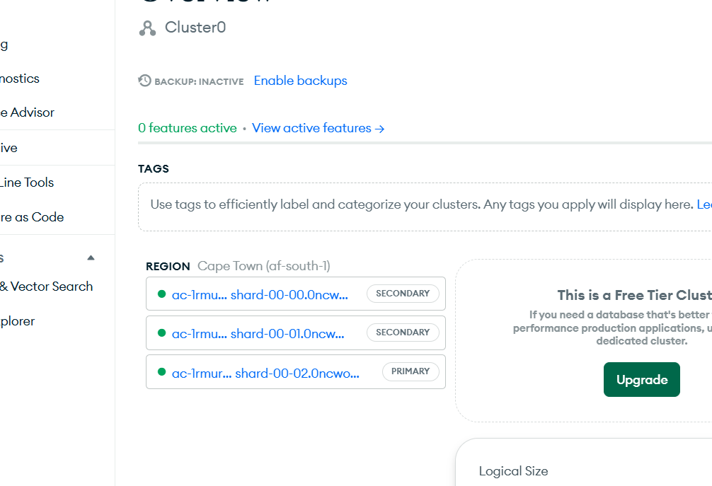
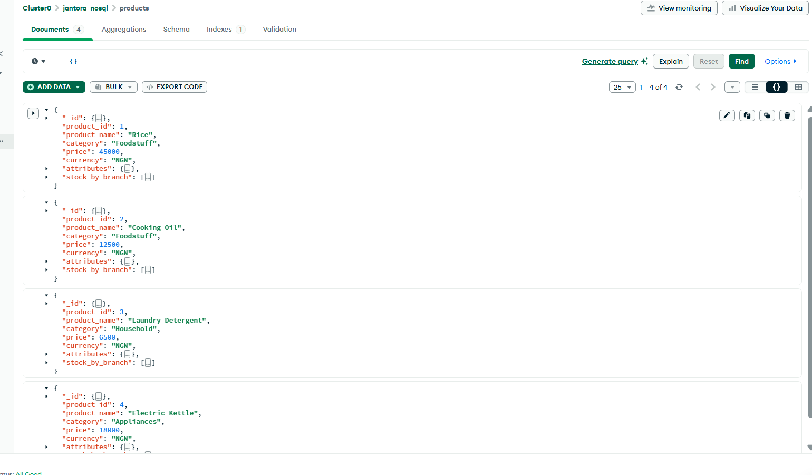
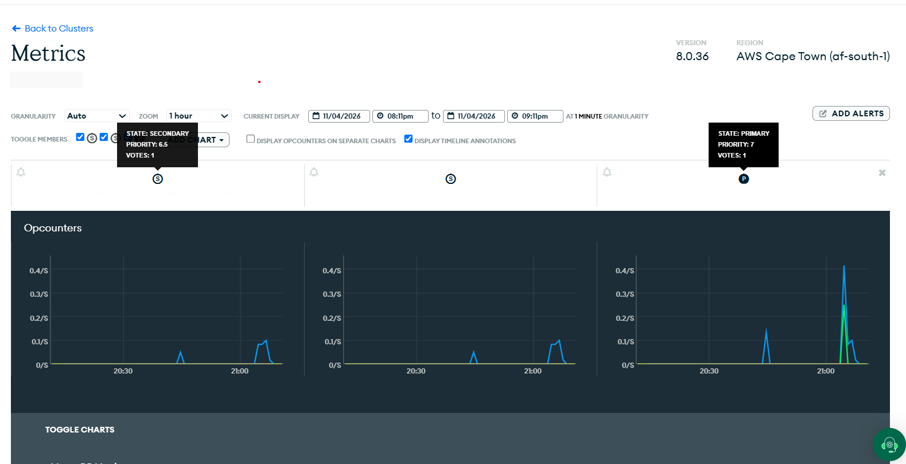

# Portfolio 5 — Distributed and Cloud Database Exercise

**Course:** MIT 8103 — Advanced Database Systems  
**Case study:** Jantora Superstores (Lagos, Nigeria)  
**Platform:** MongoDB Atlas (AWS)  
**Assessment focus:** Cloud database deployment, replication, availability, consistency and future sharding

## 1. Aim and case-study context

Jantora Superstores operates physical supermarkets and an illustrative online product catalogue and may expand to other Nigerian states. Earlier portfolios designed Jantora's relational PostgreSQL database, analysed query performance, tested transaction/concurrency controls, and modelled an illustrative product catalogue using MongoDB documents.

This portfolio documents the **existing cloud-hosted MongoDB deployment** used for Portfolio 4 and explains how distributed-database concepts could support Jantora's online catalogue. **The Atlas data is sample catalogue data, not a synchronised replica of the PostgreSQL system.**

The lecturer's requirement is: *“Distributed/cloud database discussion or setup based on the same case study, including replication, sharding, availability, consistency, or deployment evidence.”*

## 2. Actual Atlas deployment

The following details were read from the Atlas cluster Overview screenshot captured on **4 November 2026**.

| Setting | Observed configuration |
|---|---|
| Atlas project | Existing Atlas project (name omitted from public documentation) |
| Cluster | `Cluster0` |
| Tier | Free |
| Cloud provider | Amazon Web Services (AWS) |
| Region | Cape Town, South Africa — `af-south-1` |
| MongoDB version | `8.0.36` |
| Replica-set topology shown | One PRIMARY and two SECONDARY members |
| Database | `jantora_nosql` |
| Collection | `products` |
| Backups at time of screenshot | Inactive |
| Logical size at time of overview screenshot | Approximately 93.6 KB |

This deployment is hosted by MongoDB Atlas rather than a database server installed and managed on a local machine. Jantora's PostgreSQL `jantora_db` remains separate.



*Figure 1. Actual Atlas cloud deployment overview.*

## 3. Replication: observed configuration and architecture

The Atlas Overview showed **three replica-set members**: one PRIMARY and two SECONDARY nodes, each with a green status indicator at the moment of capture. This constitutes direct evidence of the deployment's replica-set topology, **not a test of failover**.

```text
               Jantora online product catalogue
                           |
                    MongoDB Atlas
                           |
                       PRIMARY
                   (accepts writes)
                     /           \
              SECONDARY 1     SECONDARY 2
              (replica)        (replica)
```

MongoDB replica sets maintain redundant copies of data. The primary ordinarily accepts writes; secondary members replicate operations from the primary. If a primary becomes unavailable and the remaining eligible members can form a voting majority, the replica set can elect another primary. This is a **documented capability**, not a failure/recovery experiment performed for this assessment [1][2].



*Figure 2. The primary/secondary roles visible on the actual Atlas deployment. Replica-set hostnames are cropped or hidden for the public repository.*

## 4. Availability: access test and limitations

Using Atlas Data Explorer, the existing `jantora_nosql.products` collection was opened and the empty filter `{}` was applied. **Four sample product documents were accessible**: Rice, Cooking Oil, Laundry Detergent and Electric Kettle. This verifies that the deployed database was reachable **at the time of testing**.



*Figure 3. Successful access to the hosted product collection.*

Replication supports high availability by providing redundant members and the possibility of election if an eligible primary fails. Nevertheless, this portfolio **does not claim** uninterrupted service, a measured uptime percentage, regional failover, or a successful forced primary failover. Atlas Free clusters do not provide manual primary failover testing [1]. A single AWS region was observed; multi-region resilience was **not** configured or tested.

## 5. Consistency and durability

Distributed replicas introduce a balance between access latency, availability and how up-to-date reads must be.

- **Primary writes:** Applications normally direct writes to the replica-set primary. Replication propagates those writes to secondary members.
- **Write concern:** `{ w: "majority" }` requests acknowledgment from a majority of voting data-bearing members. In a three-data-bearing-member replica set, a majority is two. This gives stronger durability assurance than acknowledgment from the primary alone [3].
- **Read concern:** `"local"` can read data not yet majority-confirmed. `"majority"` restricts results to majority-committed data [4].
- **Reading from secondaries:** Because secondaries apply changes asynchronously, reads from them can lag behind newly acknowledged writes. Appropriate read preference, read/write concerns and, where needed, causally consistent sessions help applications choose their consistency guarantees [3][4].

**Jantora design implication:** Product browsing can tolerate some delay in non-critical catalogue details, but checkout inventory and payment correctness demand stronger controls. The transactional PostgreSQL database developed in Portfolios 1–3 remains the model for orders, payments and authoritative inventory. The MongoDB catalogue in this assessment is illustrative and not integrated with PostgreSQL. No read/write concern configuration or cross-node consistency timing test was performed here.

## 6. Sharding: a future scaling option, not implemented

**Replication and sharding solve different problems.** Replication maintains redundant copies to improve fault tolerance; sharding partitions a dataset across multiple shards for horizontal scaling. For example, a future high-traffic Jantora catalogue might consider sharding if product volume or throughput outgrew one replica set [1][5].

Sharding is **not available on this Atlas Free cluster** and was **not configured or tested**. Any decision to shard would require a compatible deployment, suitable shard-key design, evaluation of query patterns and operational costs. Merely expanding to several Nigerian states would not, on its own, justify sharding.

## 7. Cloud monitoring evidence

The Atlas Metrics page displayed **Opcounters** charts for all three visible replica-set members over a one-hour time window on **4 November 2026**. The charts showed low-level database activity, with small spikes, and identified the PRIMARY and SECONDARY members. This supports the observation that Atlas exposed operational monitoring of the deployment; it does **not** demonstrate failover or guarantee replication lag was zero.



*Figure 4. Atlas monitoring evidence; sensitive hostnames should be removed from the public screenshot.*

## 8. Suitability and limitations for Jantora

| Feature | Relevance to Jantora | Limitation observed or acknowledged |
|---|---|---|
| Managed cloud hosting | Database infrastructure can be accessed through Atlas without local server administration | Network and provider availability remain dependencies |
| Replica-set architecture | Redundant members can support service continuity | Failover was not experimentally tested |
| Read/write concerns | Allow applications to choose durability and consistency guarantees | Settings were discussed, not benchmarked or changed |
| Atlas monitoring | Enables inspection of database operation counts and member roles | Free-tier monitoring is limited |
| Sharding | Potential future horizontal scale for a substantially larger catalogue | Not available on Free; not implemented |
| Backup/recovery | Important for recovering from accidental deletion or corruption | Atlas showed **Backups: Inactive**; replication is not a substitute for backups |

The existing deployment is an appropriate **learning-scale proof of cloud deployment and replication topology**, rather than a production-readiness demonstration. Before production use, Jantora would need to assess backups, security, operational monitoring, workload sizing, service-level requirements and the design linking its transactional database to any catalogue service.

## 9. Evidence index and reproducibility

| Evidence file | What it demonstrates |
|---|---|
| [`01-atlas-deployment.png`](evidence/01-atlas-deployment.png) | Cluster name, Free tier, AWS Cape Town region, MongoDB version |
| [`02-replica-set.png`](evidence/02-replica-set.png) | One primary and two secondary replica-set members |
| [`03-database-availability.png`](evidence/03-database-availability.png) | Successful access to four Jantora sample product documents |
| [`04-cluster-monitoring.png`](evidence/04-cluster-monitoring.png) | Atlas Opcounters monitoring for three members |

**Steps to inspect the same evidence:** Sign in to MongoDB Atlas → open the existing project and `Cluster0` → Overview (Figures 1–2) → Data Explorer, `jantora_nosql.products`, filter `{}` (Figure 3) → Metrics, choose a suitable time range and Opcounters (Figure 4). Screenshots record one point in time and do not guarantee the dashboard will look identical later.

**Submission note:** Copy the four **actual, appropriately redacted** Atlas screenshots into `evidence/` before committing to GitHub. This download intentionally does not contain the screenshots from your local computer.

## 10. Conclusion

The Jantora case study demonstrates cloud deployment through MongoDB Atlas Free hosted on AWS Cape Town. The actual cluster Overview showed one primary and two secondaries, the Data Explorer confirmed access to four illustrative product documents, and monitoring charts showed per-member operations. Replication, availability, consistency and sharding were evaluated in the context of Jantora's future growth, with a clear distinction between **observed evidence** and **features discussed but not tested**.

## References

[1] MongoDB. *Atlas Free Cluster Limits*. https://www.mongodb.com/docs/atlas/reference/free-shared-limitations/ (accessed 4 November 2026).  
[2] MongoDB. *Guidance for Atlas High Availability*. https://www.mongodb.com/docs/atlas/architecture/current/high-availability/ (accessed 4 November 2026).  
[3] MongoDB. *Write Concern*. https://www.mongodb.com/docs/manual/reference/write-concern/ (accessed 4 November 2026).  
[4] MongoDB. *Read Concern*. https://www.mongodb.com/docs/manual/reference/read-concern/ (accessed 4 November 2026).  
[5] MongoDB. *Configure Additional Settings — Sharded Clusters*. https://www.mongodb.com/docs/atlas/cluster-additional-settings/ (accessed 4 November 2026).
